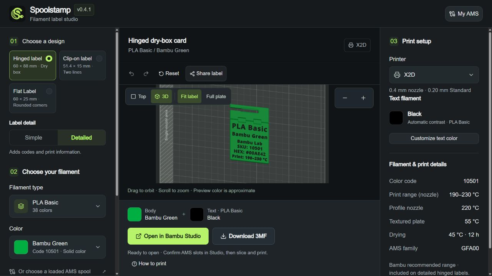
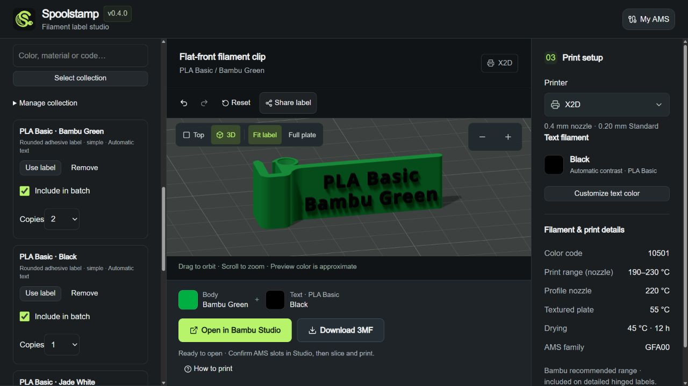
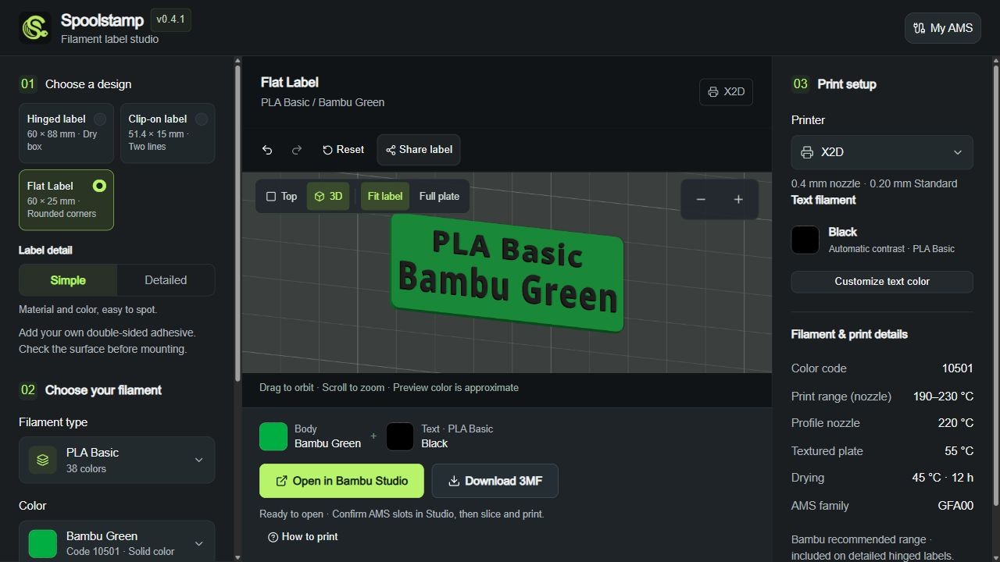
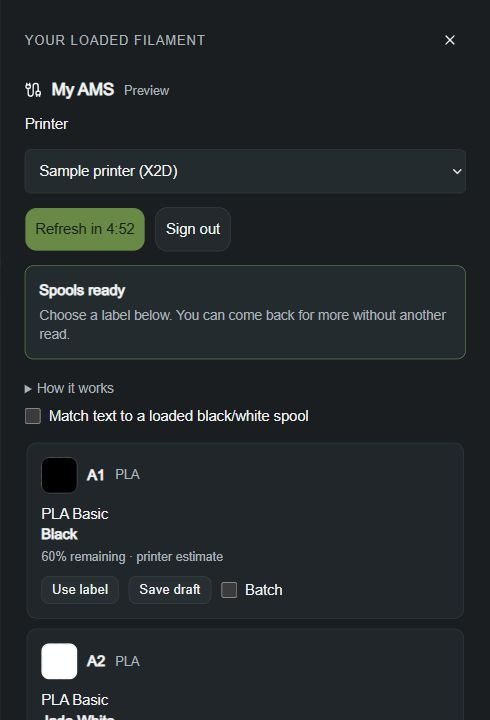

# Spoolstamp


Create 3D-printable filament labels in a few clicks. Pick a design, choose your filament, and preview your label before opening it in Bambu Studio.

**[Open Spoolstamp →](https://spoolstamp.bourhan.org/)** — use it in your browser, no installation needed.



## Features

- **Three label designs** — a hinged dry-box label, a flat-front clip-on label, and an original Flat Label with rounded corners.
- **Bambu Lab filament catalog** — 314 colors with searchable material types, color names, and codes.
- **Live 3D preview** — rotate, zoom, and switch between a label close-up and your printer's build plate.
- **Automatic lettering** — filament details filled in for you, with contrasting black or white text.
- **Clearer hinged labels** — larger color names and product-specific recommended print-temperature ranges. Unverified ranges say “Print: see guide”; Studio slicing presets are unchanged.
- **Optional text colors** — use **Customize text color** for white, black, gray, red, blue, or yellow and a compact same-material profile selector. Return to automatic text with one click.
- **Printer profiles** — 14 Bambu Lab models with matching bed dimensions and export settings.
- **Color-aware 3MF export** — separate body and text filament profiles, ready to open and slice in Bambu Studio.
- **My AMS cloud connection** — connect in your browser, choose loaded spools, suggest compatible text filament, and batch-export labels. Open to all global-region Bambu accounts; no local helper needed.
- **One-click Studio opening** — available when running locally alongside Bambu Studio.
- **Responsive workspace** — designed for desktop, tablet, and phone.
- **Saved workspace** — optionally remember your setup, favorite Bambu filaments, and save label drafts on this browser. No account required; Bambu login data is never saved with them.
- **Multi-label plates** — arrange selected AMS labels or saved drafts into plate projects, conservatively grouped by body/text product pair and split for bed space or a four-filament limit. Separate-project ZIP export is still available.
- **Helpful checks** — advisory low-contrast warnings, AMS snapshot-age/cooldown guidance, cloud-outage fallback, and larger mobile controls with quick download access.
- **Flat adhesive label** — an original 60 × 25 mm design with raised product/color lettering. Supply your own adhesive; physical printing and mounting still need testing.
- **Editing and sharing** — undo/redo, reset, and catalog-only label links; links never include Bambu login data or printer serials.
- **Workspace backup** — export favorites, drafts and named collections to a local JSON file, then merge them into another browser without replacing existing saved items.
- **Batch preview and copies** — choose quantities and inspect the actual planned plate bounds, project splits and filament assignments before downloading.
- **Named collections** — group saved catalog labels, search them, and select a collection to reprint. Collection names and choices stay on this browser unless you export a backup.
- **Simple or Detailed** — choose prominent material/color lettering or additional label details; the narrow clip stays two-line.
- **Printing help and updates** — open **How to print** beside export, or click the version badge for **What's new**.

## Clip-on labels

A flat face with two lines: material type and color.



## Flat adhesive labels

Choose **Flat label** for an original 60 × 25 mm backing with raised product, color and catalog-code lettering. Add your own suitable adhesive after printing. See [design details and print guidance](docs/adhesive-label.md); physical printing and mounting still need testing.

**Flat Label** has softened corners. Under **Label detail**, choose **Simple** for prominent material/color text, or **Detailed** for the catalog code when it fits. Hinged labels offer the same choice; their detailed layout includes print information. Older flat-design drafts, collections and links open this retained design.



## Edit, share and keep your labels

Use the toolbar above the preview to **Undo**, **Redo**, **Reset**, or **Share label**. Share links restore catalog choices without including Bambu account data or live inventory.

Save favorites and drafts under **My saved filaments**. Open **Backup & restore** to download a JSON backup or import it into another browser. After importing, choose **Use imported setup** if you want to apply the backed-up label. See the [step-by-step guide](docs/label-editing.md).

Organize saved labels into named collections, then choose a collection and select it for a batch. Set the copies you need, choose arranged plates or separate projects, and click **Preview batch**. Review the preview and download that prepared layout. Editing the choices invalidates the old preview. See [batch previews](docs/batch-preview.md).

New to Studio? Open **How to print** beside the download controls, or read the [printing guide](docs/printing.md). Click the version beside the logo to see [release highlights](docs/whats-new.md).

## My AMS

Read your loaded spools directly through Bambu Cloud, then create labels without looking up each filament. The browser flow has been tested with a real X2D on the live website.

1. Open **My AMS → Connect Bambu Cloud**.
2. Enter your Bambu account email, accept the connection notice, and request a verification code.
3. Sign in with the code, select your cloud-connected printer, and click **Read AMS**.
4. Confirm your loaded spools, then use a label or select spools for a batch ZIP export.



Current interface shown with synthetic sample spools. Dated real-printer evidence and qualification limits are documented in [My AMS](docs/ams-integration.md).

Sign in with your global-region Bambu account—no invitation or account approval is needed. Your printer must be cloud-connected. The manual filament picker is also available without signing in.

The connection lasts up to 30 minutes, starting when you connect. Credentials stay server-side, temporarily encrypted; verification codes are not stored. Reads are on demand with a five-minute cooldown, and live-slot actions require a snapshot less than 45 seconds old. Resolved catalog label choices remain reusable for this visit, so returning for another label does not require another read. Remaining filament is the printer's estimate. See [My AMS](docs/ams-integration.md) for privacy details and current validation limits.

Save an AMS label draft while the read is fresh to edit or export it later from **My saved filaments**. A saved draft is a catalog configuration, not current inventory. Confirm your physical spools, all filament assignments, label spacing, brim and purge-tower clearance in Studio before slicing. Multi-label placement is digitally checked; real multi-label printing is not yet qualified. See [Saved workspace and plates](docs/saved-workspace.md).

## Run locally

The version beside the logo comes from `package.json`. See the [changelog](CHANGELOG.md) and [release workflow](docs/releases.md).

See [editing, sharing and workspace transfer](docs/label-editing.md), [flat label details](docs/adhesive-label.md), and the [v0.4.0 review](docs/review-v040.md) for validation scope and remaining limitations.

Requires Node.js 22.13 or newer.

```sh
git clone https://github.com/byassin/spoolstamp.git
cd spoolstamp
npm ci
npm run dev
```

Open `http://localhost:3000`.

## Documentation

[Hosting](docs/hosting.md) · [My AMS](docs/ams-integration.md) · [Print ranges](docs/print-temperature-ranges.md) · [Bambu Studio](docs/local-studio-handoff.md) · [Development](CONTRIBUTING.md) · [Architecture](docs/architecture.md)

The [browser-hosted cloud AMS connection](docs/hosted-cloud-ams.md) is deployed separately from the static website. Sign-in is open to all global-region Bambu accounts. Real X2D sign-in and a fresh cloud snapshot have been demonstrated; additional printer and lifecycle testing is ongoing.

## License

Application code: [MIT](LICENSE). Data, model, and font notices: [NOTICE-DATA.md](NOTICE-DATA.md).

Spoolstamp is an independent project, not affiliated with Bambu Lab.
