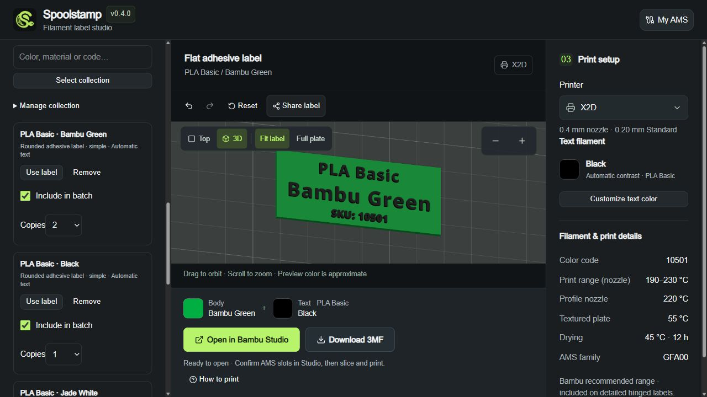
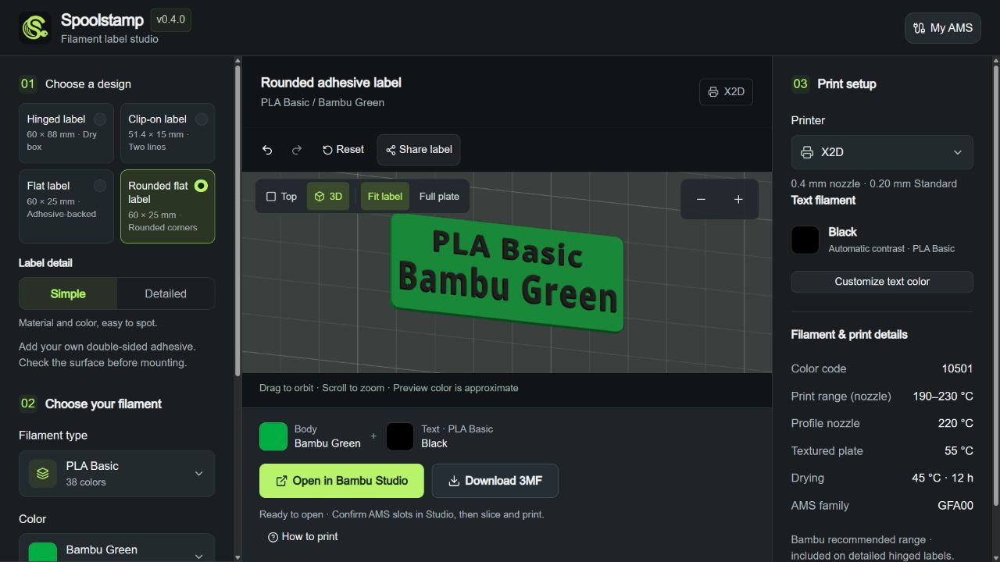

# Flat adhesive label

## Create and print

1. Select **Flat label** under **Choose a design**, then choose the filament and color.
2. Pick your printer. Keep automatic text contrast, or open **Customize text color** to match the actual text spool.
3. Download the 3MF and open it as a project in Bambu Studio. Confirm body/text assignments and inspect the sliced lettering before printing backing-down.
4. Test the finished label and your chosen adhesive on the intended surface before mounting.

## Dimensions and validation

An original 60 × 25 mm rectangular label with a 1.6 mm flat backing and 0.8 mm raised lettering. Unlike the supplied hinged card and clip, it has no moving parts, clip clearance, holes or model-specific mounting mechanism. Supply suitable double-sided tape or adhesive yourself; none is modeled or included.

The product and color are the main two lines. A small catalog color code is included when the color fits one line. Long colors wrap over two lines instead of reducing strokes below the existing 0.4 mm-nozzle screening limits; full names remain in text metadata. Body and raised text use separate material roles, retaining the existing same-family text-color/profile controls.

Print backing-down at Z=0. No scaling or rotation of a supplied community model is involved. Tests check closed positive-volume meshes, backing dimensions, glyph-to-backing intersections, and printable in-bounds text for the catalog. These digital checks are not native Studio slicing or physical adhesive/durability qualification. Test the intended adhesive, substrate, temperature and filament yourself.

Implementation: `lib/adhesive-label.ts`. Physical qualification is explicitly pending.

## Rounded flat label and layout presets

**Rounded flat label** is another original adhesive-backed design. It retains the 60 × 25 × 1.6 mm backing, 0.8 mm text relief and the same text-safe area. A 2 mm radius rounds only the outer corners inside the existing border; the supplied hinged card and clip mechanics are not changed. The curve is modeled with eight segments per quarter-circle. Corner radius and backing dimensions are included in the exported project's provenance.

Choose **Simple** for prominent full product/color names, or **Detailed** for the existing catalog-code layout. Simple long color names still wrap rather than being abbreviated; Detailed retains the SKU when a single color line leaves enough room. Existing drafts without a layout use Detailed, so their previous flat-label content stays intact. The narrow supplied clip remains fixed at two-line Simple; no additional fine print is squeezed onto it.

On the hinged card, Simple keeps the original 54 mm-wide text-safe region and only removes the extra brand/SKU/HEX/temperature rows. Product and color headlines are enlarged with bounded horizontal condensation while retaining the existing printable-stroke screening. Detailed keeps the previous rows and layout. Source mechanics and hinge clearances remain unchanged.

Regression checks cover closed positive-volume rounded backing, per-glyph backing intersections in both layouts, catalog-wide Simple readability, layout-separated mesh caches, actual-layout metadata, and every design/layout on every catalog printer's shared nozzle bed. These checks do not qualify a physical print, adhesive bond, or native Studio slicing.
