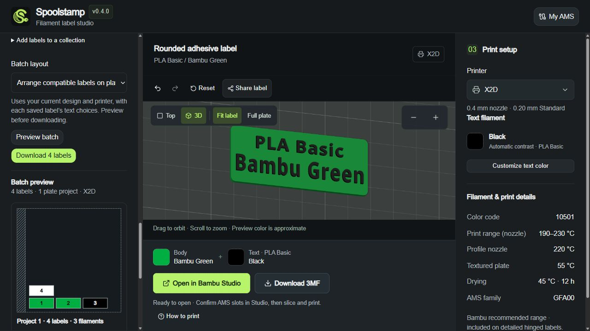
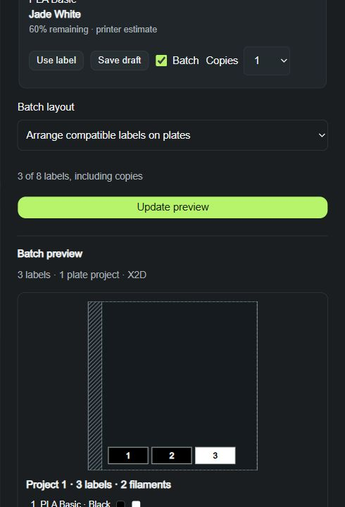

# Batch previews and copies

## Prepare a batch

1. In **My saved filaments**, select drafts or choose and select a collection. In **My AMS**, select fresh resolved slots. Choose the number of copies for each selected label.
2. Keep the total at **eight labels including copies**. Choose **Arrange compatible labels on plates** or **Separate 3MF projects**.
3. Click **Preview batch**. Review the number of projects, numbered label bounds, restricted bed areas and project filament list.
4. Download the prepared ZIP. Extract it, then open each 3MF as a project in Bambu Studio and confirm its physical spool assignments and sliced clearances.

The preview and ZIP consume the same captured plan and whole-assembly transforms. Copies count as independent label objects; repeated labels in separate mode receive distinct project filenames. Changing selections, quantities, layout, design, printer or relevant text choices invalidates the previous preview. Saved-workspace edits also invalidate a saved batch. AMS batches retain existing freshness and cancellation checks.

## What the preview shows

This is a top-down **bounds preview**, not a sliced toolpath or photorealistic model preview. Numbered rectangles show the actual planned label bounds. Stripes show bed restrictions; filament details list the profiles/colors required by the project. Separate mode centers one assembly per project; arranged mode uses the existing common-nozzle bed area, clearances and spacing without scaling or rotating source mechanics.

Arranged projects group exact body/text product pairs and split for printable space or the four-filament project limit. Combined support-material projects remain unsupported. The displayed project count includes those splits.

Studio still determines sliced brim and purge-tower clearance and final physical spool assignments. Digital placement does not qualify physical printing, fit or adhesion.

## AMS example

The screenshot uses local sample inventory. Preparation and export retain the live-read freshness checks; after expiry, catalog-only choices from the last read remain available separately.
