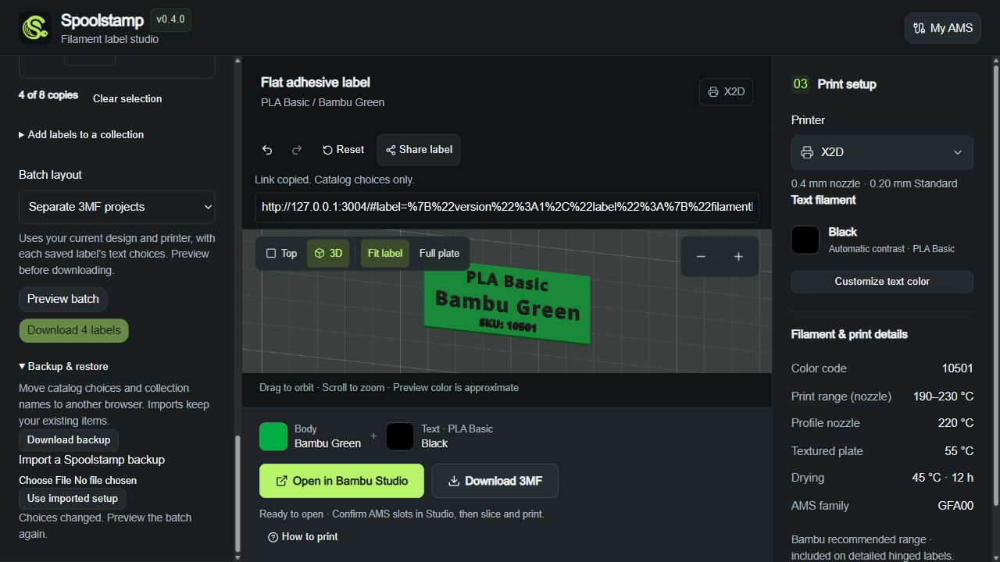

# Editing, sharing and workspace transfer

## Edit a label

Choose a design, filament and printer, then use the toolbar above the preview. **Undo** and **Redo** move between recent choices; **Reset** returns to the default label. Saved favorites, drafts and collections stay available.

The editing toolbar provides undo, redo, reset and **Share label**. Undo/redo covers the last 30 label-configuration changes: filament, design, printer profile, label layout and text choices. It does not undo favorite/draft/collection operations or make/cancel Bambu requests. Reset returns the builder to its default configuration without deleting saved items. Configuration changes, including undo/redo, invalidate in-flight model downloads and Studio preparation.

## Share a setup

1. Finish choosing your label and click **Share label**.
2. Paste the copied link into your message. If copying is unavailable, select and copy the **Shareable label link** field.
3. Open the link in another browser to restore its design, filament, printer profile, label layout and text choices. Confirm the physical spools in Studio before printing.

**Share label** copies a link and exposes a selectable copy field. The URL fragment contains only a versioned catalog filament ID, printer _profile_ ID, design and allowed layout/text options. It contains no collection names, Bambu email, code, cookie, token, physical printer ID or AMS inventory. Fragments are not sent in the HTTP request; the choices can still appear in browser history or wherever a user shares the link. Shared choices override remembered setup on initial load and also respond to same-page fragment navigation. Unknown or oversized links leave the builder unchanged and show an error.

## Organize and reprint collections

Under **My saved filaments**, choose a collection or **All drafts**, then search for a material, color or code. Create a named collection from selected rows, or create an empty one and add the current label. **Manage collection** contains rename, add-current-label and removal controls. Select saved labels and choose **Add selection to collection** to keep independent copies without overwriting existing labels.

**Select collection** selects all its labels for reprinting. Choose copies per row (eight total per batch), click **Preview batch**, review the plate and filament assignments, then download. Changing print choices requires a new preview; download uses the exact prepared plan shown. Collection limits are eight collections, eight labels each, and 40 visible characters per name. Names and catalog configurations stay on this browser; no collection account or cloud synchronization is added.

## Move favorites, drafts and collections

1. Open **My saved filaments → Backup & restore** and click **Download backup**.
2. On the destination browser, open the same section and choose your JSON file under **Import a Spoolstamp backup**.
3. Review the import result. Your existing favorites, drafts and collections are retained. Choose **Use imported setup** to apply the backed-up label, or keep editing the current one.

Under **My saved filaments → Backup & restore**, **Download backup** exports setup, favorites, drafts and collections as a local JSON file. Import is limited to 96 KB and strictly validates schema, fields, bounded collection names/IDs and current catalog choices. Old v1 files still import. Identical items are deduplicated; conflicting collection IDs/names produce a separate copy instead of replacing existing work. Capacity overflow rejects the whole import. Imported setup is applied only after **Use imported setup**. Remember-setting and login state are not transferred. The file is not encrypted and contains catalog choices plus user-entered collection names; Bambu credentials and live inventory are never automatically included.

## Multiple tabs and storage limits

Current app tabs synchronize saved lists through `spoolstamp.workspace.v2` storage events. On first use, if that namespace is absent, validated choices are copied from the old v1 namespace without changing it. Existing v2 data always takes precedence. Later edits in an older app tab stay in v1 and cannot erase current collections or layouts; they are not automatically merged. Record/backup format version 1 and old backup imports remain supported.

Before writing, a tab checks whether the current record changed; unseen changes load the latest workspace and ask the user to retry rather than overwriting it. This is best-effort optimistic detection, not atomic multi-process locking: truly simultaneous writes remain a limitation. External setup changes do not unexpectedly replace an actively edited label. Browser storage may be blocked or cleared; recovered choices can last only for the visit if migration cannot be saved. Keep a backup if the drafts matter.
