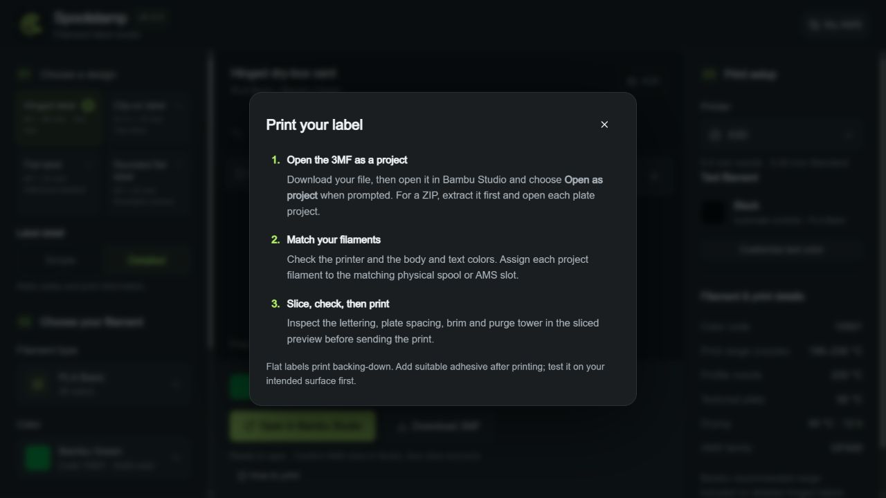
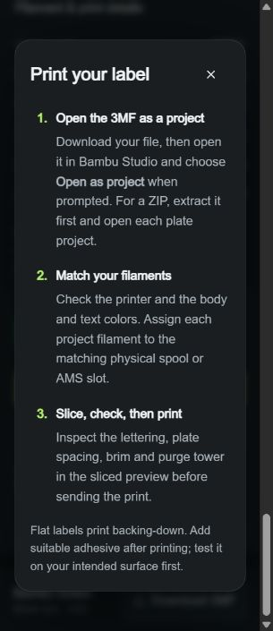

# Print a Spoolstamp label

The **How to print** button beside the export controls opens the same short guide in the app.

1. **Open as a project.** Download the 3MF, open it in Bambu Studio, and choose **Open as project** when prompted. Extract a batch ZIP first; each 3MF is an independent project or plate.
2. **Match the filaments.** Confirm the target printer and assign every body/text project filament to its matching physical spool or AMS slot. A matching screen color does not confirm which spool is loaded.
3. **Slice and inspect.** Check lettering, plate spacing, brim and purge-tower clearance in Studio's sliced preview before sending the print.

Flat labels print backing-down. Add your own suitable adhesive after printing and test it on the intended surface. Hinged and clip designs retain their established print orientation and supplied mounting geometry.

Spoolstamp exports unsliced projects. Its mesh, text and placement checks do not replace native Studio slicing, physical print/fit checks or adhesive durability testing.

