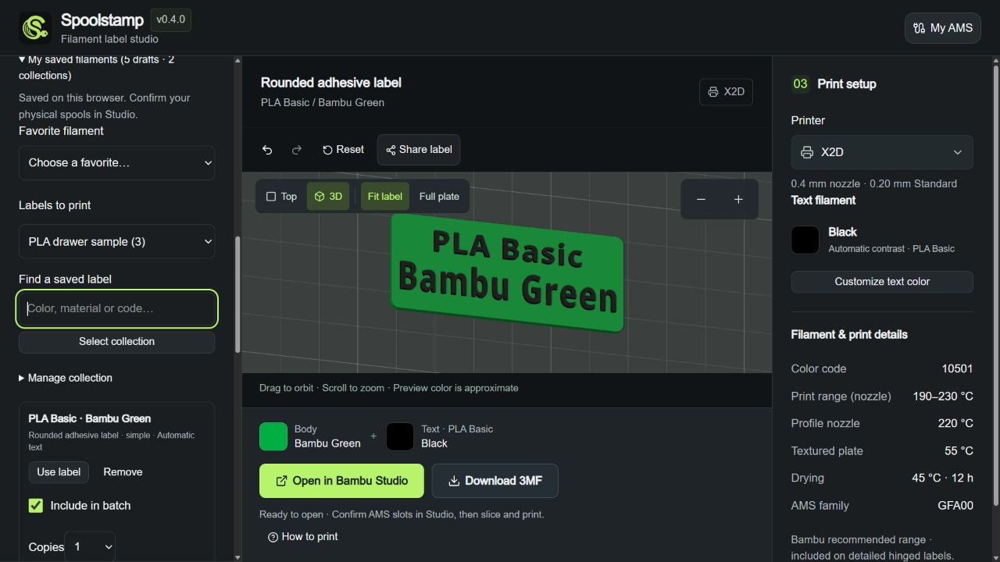

# Saved workspace and multi-label plates

Spoolstamp remains limited to the Bambu catalog. This release adds no custom brands or account system.

## Browser-only choices

- Enable **Remember my setup on this browser** to restore the last catalog filament, printer profile, design, label layout and text choice after reloading. Disable it to stop remembering and remove the saved setup.
- **Save favorite** keeps a catalog shortcut; select it under **My saved filaments**.
- **Save label draft** keeps a catalog label configuration for later. AMS **Save draft** requires a fresh, resolved spool and a confirmed compatible automatic text profile, or an explicit manual text choice.
- At most 16 favorites and 16 drafts are retained. Remove individual items in the saved workspace. If storage is unavailable, an explicit notice says they last only for this visit.
- Keep up to eight named collections, each with eight distinct saved labels. Names have 1–40 visible characters. Collections contain independent catalog configurations: removing a draft does not remove its collection copy, and removing a collection keeps separate drafts and favorites.

The `spoolstamp.workspace.v2` browser-storage namespace contains catalog filament IDs, printer _profile_ IDs, design IDs, allowed layout/text options, and local collection IDs/names. Bambu email, code, token, CSRF, physical printer serial, slot identity, remaining percentage and live inventory timestamps are never copied into it. Collection names are user-entered text; avoid personal information if you plan to share a backup. Loading revalidates all choices against the current catalog. Saved preferences do not extend a Bambu session. The record and backup format versions remain 1; omitted layouts retain the previous detailed layout, while clips remain simple.

When the new namespace is absent, existing `spoolstamp.workspace.v1` choices are validated and copied once. An existing v2 record always wins. The old key is left unchanged, and later writes from older open tabs are not merged into the current workspace. This isolation prevents an older app from erasing collections or layout choices it cannot understand. Tabs running the current app still synchronize through v2 storage events and stale-write checks. If migration cannot be persisted, recovered choices remain available for this visit with a storage notice.

Drafts are not live inventory and can be exported without signing in. They say to confirm the physical spools in Studio. Expired AMS snapshots still cannot be used to create new drafts or live exports; the 45-second freshness and five-minute vendor-read cooldown are unchanged. No stale inventory is silently upgraded to current inventory.

**Labels from your last read** is a separate, memory-only collection of exact catalog choices captured while a read was fresh. It lets you return for another label after the live snapshot expires, without waiting for another read. It contains no live slot identity or quantities and makes no claim about what is still loaded. Choosing a cached catalog label works like the manual picker; **Save label draft** in the main builder can keep that configuration across reloads. The live-slot **Save draft** button still requires a fresh snapshot.

## Collections and reprints

Open **My saved filaments**. Choose **All drafts** or a named collection under **Labels to print**, then search by color, material, code or layout. Under **Create a collection**, enter a name and create an empty collection or create one from selected labels. Add the current builder label through **Manage collection → Add current label**, or select saved rows and use **Add selection to collection**. Adding deduplicates exact configurations and never replaces an existing collection label. Rename and remove controls are under **Manage collection**; removing a whole collection requires a separate confirmation.

Choose a collection and click **Select collection** to reprint all its labels. Set copies per row, then preview the batch. Copy counts are temporary print choices, not inventory quantities or persistent collection entries. A batch contains at most eight labels including copies. **Use label** restores one full saved configuration for editing; collections can be printed without signing in to Bambu.

Backups include collections and their names as well as setup, favorites and drafts. The format remains v1 with optional new fields; old backups import. Files are bounded to 96 KB, including UTF-8 bytes. Imports deduplicate matching collections, keep a separate named copy if an imported ID/name conflicts, and reject the entire import if any capacity would overflow. They never replace current saved work or automatically apply an imported setup. See [editing and transfer](label-editing.md).

## Plate projects

Select loaded labels, saved drafts or a collection, set copies, and choose **Arrange compatible labels on plates** or **Separate 3MF projects**. Click **Preview batch** before downloading the ZIP. The preview shows the prepared plate positions, bed restrictions and body/text filament assignments; download serializes that same prepared plan without repacking. Changing selected labels, copy counts, design, printer or batch layout invalidates the visible plan and requires another preview. Saved batches use the currently selected design and printer with each saved label's text/layout choices; individual **Use label** restores its complete configuration.

Labels are grouped conservatively by the exact body and text product pair, not merely a broad material family. Support profiles are rejected for combined plates. Every body/text profile must exist for the chosen printer and 0.4 mm nozzle. Within each group, a plate has at most four unique profile/color combinations; duplicates share a project filament. Extra colors or insufficient bed space produce additional projects.

Packing uses whole-assembly translations, 10 mm bed/exclusion clearance, 6 mm spacing between label bounds, the common dual-nozzle printable area, and printable height. It never scales/rotates source mechanics or changes cached vertices. New unsupported bed shapes are rejected. Project filament vectors, purge matrices and multipart assignments are generated for the actual filament count. Existing single-label exports and slicing presets remain unchanged.

Automatic placement checks label bounds, not the final sliced toolpath. Open each project in Studio, confirm physical AMS spool assignments, and inspect brim and purge-tower clearance before slicing. Default purge values are not color-calibrated recommendations. No new physical-fit, multi-label print or broader printer compatibility qualification is claimed.

## Other improvements

Manual text colors with estimated contrast below 3:1 show an advisory suggestion, never a blocking restriction. Transparent palettes skip this numerical estimate; actual filament finish and lighting can differ from screen colors. This is not a physical readability or accessibility certification.

Mobile controls have larger tap targets and a bottom quick-download bar. AMS status shows snapshot age and time to another read. During outages, manual picking and saved drafts remain usable. Only session-state GET polling backs off to at most 60 seconds; email requests, sign-in and printer reads are never automatically retried. Authentication, credential handling and provider read limits are unchanged.

Regression coverage includes storage validation/secret-field stripping, bounded collection operations and import conflicts, legacy storage/backups, advisory contrast, the exact freshness boundary, outage sanitization/no POST retry, offered designs across catalog printer beds, plate splitting, geometry preservation, and 3MF profile/filament assignments. Real printer qualification still needs consenting physical tests.

Local browser checks on October 11, 2026 covered desktop (1440 px), mobile (390 px), and narrow mobile (320 px): contrast suggestion, remembered setup after reload, favorites/draft persistence, clearing manual overrides when restoring an automatic draft, disabling remembered setup without deleting drafts, mobile quick download, and a two-label saved plate ZIP. The downloaded clip-label project had two independent assemblies and correct black/white role assignments for A1 mini. No Bambu credentials were entered and no vendor reads were requested. Native Studio slicing and physical multi-label printing remain unqualified.
