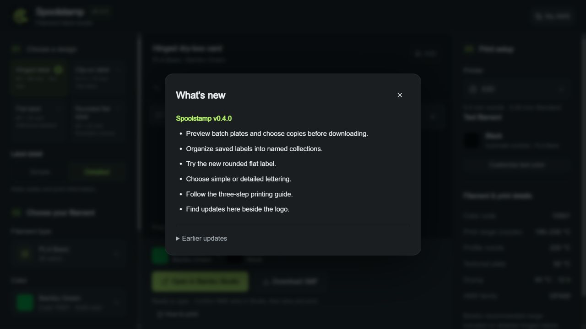

# What's new in Spoolstamp

Click the version badge beside the logo to open short highlights for your current version. Expand **Earlier updates** for previous releases, then use the close button or Escape to return to your label. The badge uses the package version; there is no footer.

The app reads these highlights from `lib/release-notes.ts`. Detailed changes and release dates remain in the [changelog](../CHANGELOG.md); publication follows the [release workflow](releases.md).
